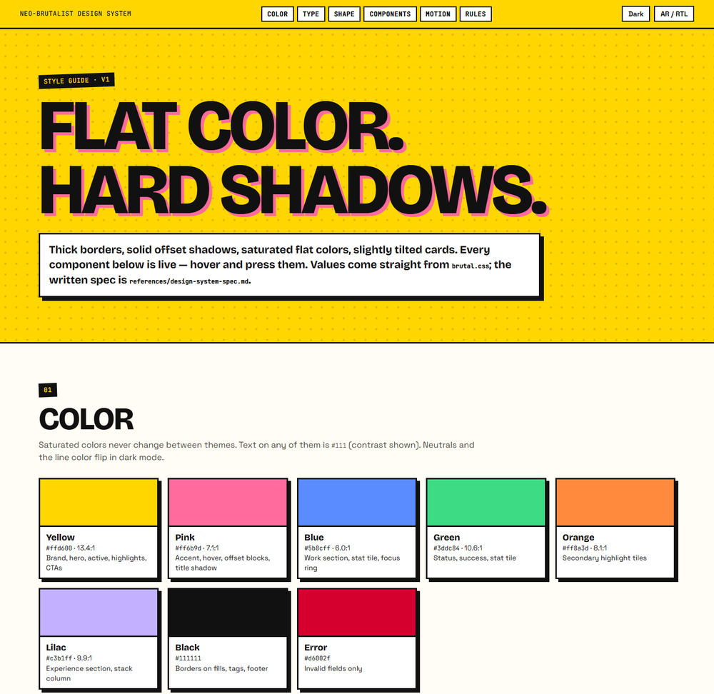
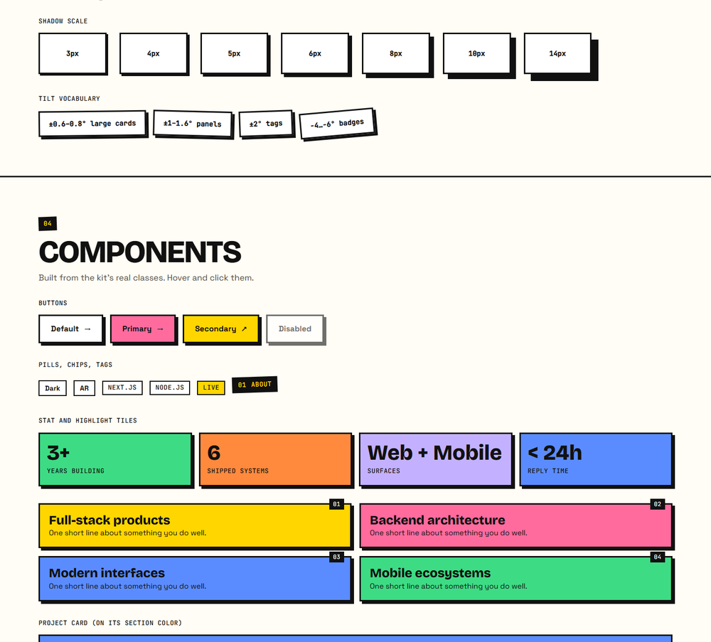

# Design system — neo-brutalist

Flat saturated color, thick borders, solid offset shadows, slightly tilted cards. Light and dark themes, English and Arabic (RTL).




> **Open the live style guide:** after cloning, open [`design-system/styleguide.html`](design-system/styleguide.html) in a browser (it loads the kit's real stylesheet, has a light/dark toggle and an RTL toggle, and every component is hoverable).

## At a glance

| | |
|---|---|
| **Palette** | yellow `#ffd600` · pink `#ff6b9d` · blue `#5b8cff` · green `#3ddc84` · orange `#ff8a3d` · lilac `#c3b1ff` · black `#111` |
| **Neutrals** | paper `#fffdf5` / `#151515` · card `#fff` / `#242424` · text `#111` / `#f5f1e6` · line `#111` / `#f5f1e6` |
| **Rule** | Text on any saturated fill is `#111` (contrast 6.0–13.4 : 1); only neutrals flip with the theme |
| **Type** | Bricolage Grotesque 800 (display, uppercase) · Space Grotesk (body) · JetBrains Mono (labels) · Cairo (Arabic, no tracking) |
| **Shape** | square corners · `3px` borders · solid shadows `3 4 5 6 7 8 10px` (no blur) · tilt `±0.6°–2°` |
| **Interaction** | hover: lift `translate(-3px,-3px)` + shadow `+3px` · press: `translate(5px,5px)` + shadow `0` |
| **Motion** | spring easing `cubic-bezier(.34,1.56,.64,1)`, 0.18–0.3s, transform + opacity only |
| **Breakpoints** | 1000px (tablet) · 720px (mobile) · 560px · `hover:none` · `prefers-reduced-motion` |

## Where everything is

| What | File |
|---|---|
| Exact specification (every value, color usage map, component anatomy) | [`references/design-system-spec.md`](references/design-system-spec.md) |
| Class catalog, section recipes, how to extend | [`references/design-system.md`](references/design-system.md) |
| Design tokens as JSON | [`design-system/tokens.json`](design-system/tokens.json) |
| Design tokens as CSS variables (standalone, any project) | [`design-system/tokens.css`](design-system/tokens.css) |
| Living style guide | [`design-system/styleguide.html`](design-system/styleguide.html) |
| Full stylesheet used by the React kit | [`assets/src/brutal/brutal.css`](assets/src/brutal/brutal.css) |

## Use it in any project

```html
<link rel="stylesheet" href="design-system/tokens.css">
<div class="nb">
  <div class="nb-surface nb-surface--lift">A card that lifts on hover and presses on click.</div>
</div>
```

Set `document.documentElement.dataset.theme = 'dark'` for the dark theme and `lang="ar" dir="rtl"` for Arabic.
